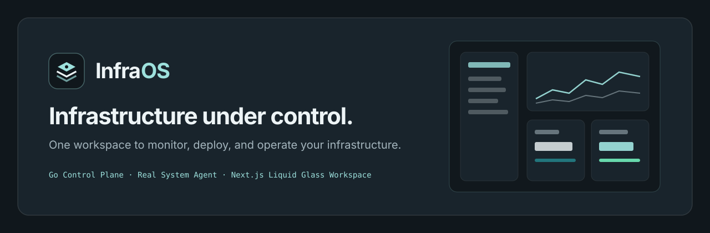
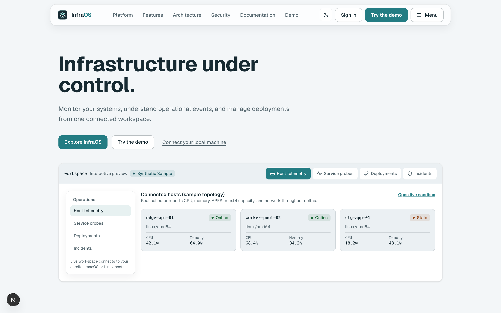
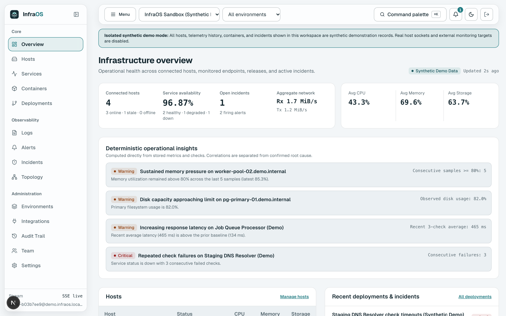
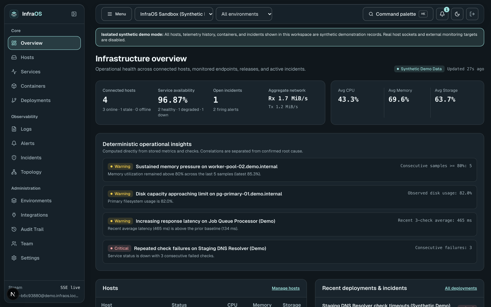
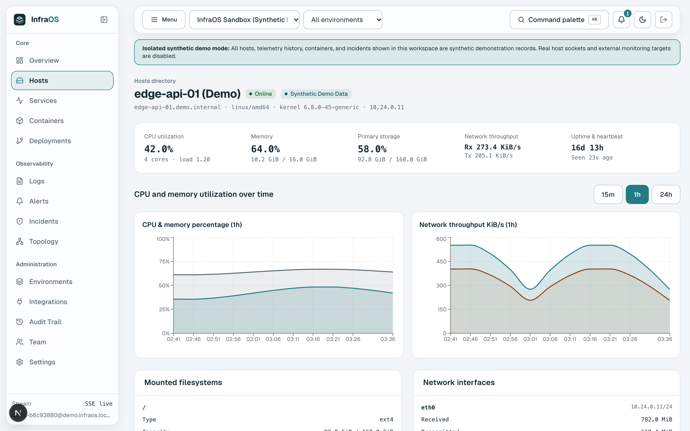
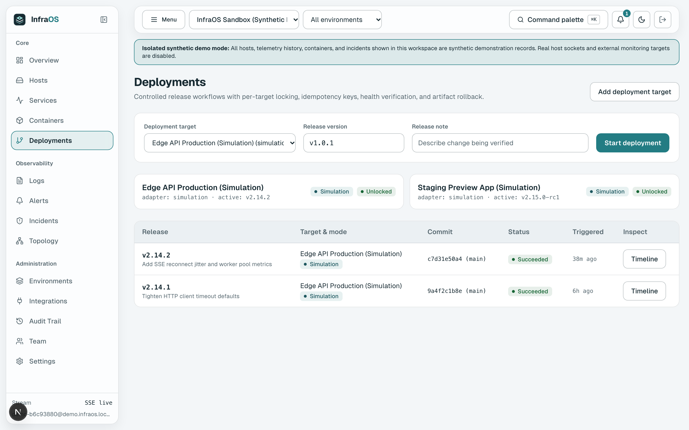
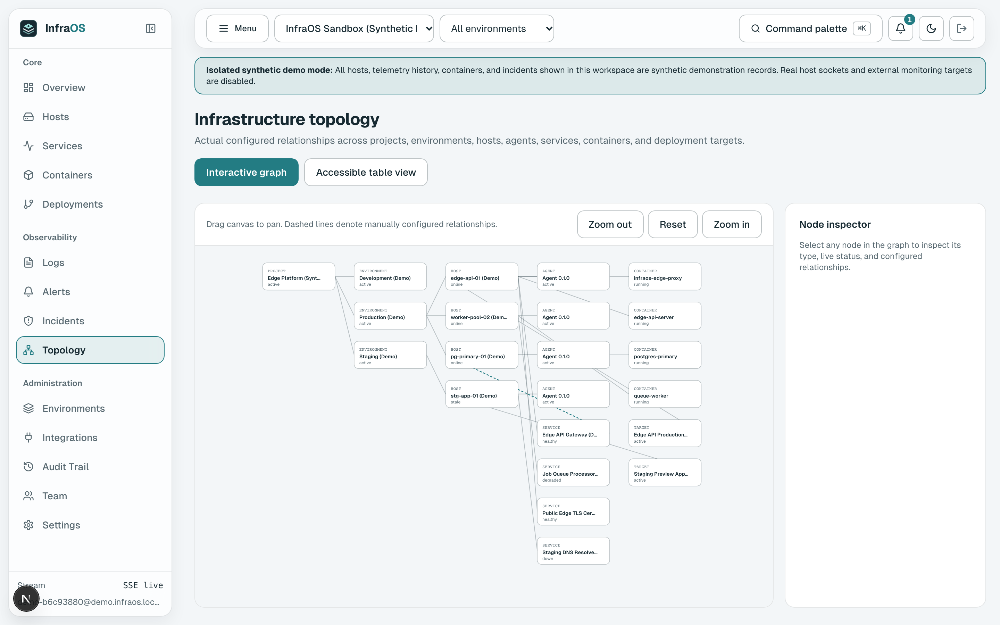
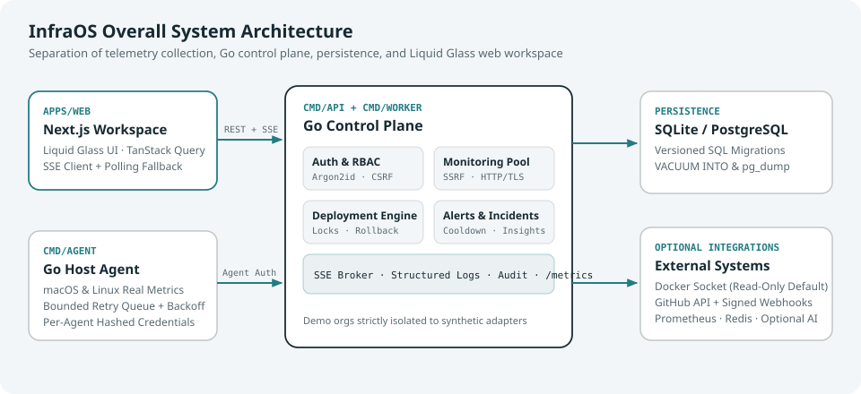

<p align="center">
  
</p>

<h1 align="center">InfraOS</h1>

<p align="center">
  An infrastructure operations platform built with Go and Next.js, featuring real-time system monitoring, service observability, controlled deployment workflows, and a refined Liquid Glass workspace.
</p>

<p align="center">
  <a href="#application-preview">Preview</a> ·
  <a href="#real-functionality-vs-synthetic-demo-mode">Real vs. Demo</a> ·
  <a href="#architecture">Architecture</a> ·
  <a href="#quick-start-lightweight-profile">Quick Start</a> ·
  <a href="#documentation">Documentation</a> ·
  <a href="#verification-status--known-limitations">Verification &amp; Limitations</a>
</p>

---

## Overview

InfraOS unifies host telemetry, endpoint monitoring, structured log inspection, alert routing, incident response, controlled deployments, and infrastructure topology inside a single control plane and workspace.

It supports two operational profiles:

- **Lightweight Development Profile (default):** Go API with embedded scheduler/worker, pure-Go SQLite (`WAL` mode, foreign keys, `VACUUM INTO` backups), Next.js frontend, and optional local macOS/Linux telemetry agent.
- **Infrastructure Profile (`docker-compose.yml`):** Separated Go API and background worker, PostgreSQL 16, Redis 7, Nginx reverse proxy with TLS template, and optional Prometheus + sample target containers.

---

## Application Preview

> All screenshots below are captured from the live running Next.js + Go stack using the public landing page and the **isolated synthetic demonstration mode** (`*.demo.internal`). No real workstation hostnames, IP addresses, or credentials are shown.

### Public Landing Page


### Liquid Glass Workspace — Light & Dark Themes (Synthetic Demo)
| Light Mode Overview | Dark Mode Overview |
| --- | --- |
|  |  |

### Host Telemetry, Controlled Deployments & Topology (Synthetic Demo)
| Host Telemetry Charts | Controlled Deployments |
| --- | --- |
|  |  |



---

## Real Functionality vs. Synthetic Demo Mode

InfraOS strictly separates real infrastructure operations from demonstration data at both the database and API layers:

| Capability | Real Authenticated Workspace (`/register`, `/login`) | Isolated Synthetic Demo (`/demo`) |
| --- | --- | --- |
| **Host Telemetry** | Real Go agent (`cmd/agent` + `pkg/collector`) collecting live macOS/Linux CPU, cores, load averages, memory, mounted filesystems, counter-reset-safe network throughput, uptime, and optional battery/process counts. | Pre-seeded synthetic hosts (`is_synthetic = true`) with 3 hours of labeled demo time-series data. Agent enrollment returns `HTTP 403`. |
| **Service Monitoring** | Real SSRF-validated HTTP, HTTPS, TCP, DNS, and TLS certificate checks with observation-based uptime calculation (no fabricated uptime percentages). | Pre-seeded synthetic service checks (`is_synthetic = true`). External and local probes are blocked (`HTTP 400`). |
| **Containers** | Optional read-only Unix-socket Docker Engine inspection (`INFRAOS_DOCKER_ENABLED=true`); mutations remain disabled unless explicitly allowlisted. | Switches to `synthetic_demo` records. Host Docker socket access is disabled. |
| **Deployments** | Controlled deployment engine with atomic per-target SQL locking (`HTTP 409` on contention), idempotency keys, health verification, artifact rollback, and explicit simulation/webhook/local-script adapters. | Restricted strictly to clearly labeled `simulation` adapter (`HTTP 400` for non-simulation adapters). |
| **Operational Insights** | Deterministic server-side analysis over stored host metrics, service checks, and deployment timestamps (correlations explicitly separated from root cause). Optional external AI summarizer is disabled by default. | Deterministic insights computed over the sandbox organization's synthetic telemetry. |
| **Security & Isolation** | Multi-tenant organization scoping, Argon2id password hashing, HttpOnly CSPRNG sessions, CSRF tokens, per-IP login rate limiting, server-side RBAC, agent token rotation/revocation, and immutable audit logs. | Isolated temporary organization (`is_demo = true`) scoped strictly to the visitor's session; live database backups blocked (`HTTP 403`). |

---

## Architecture



### Tech Stack

| Layer | Implementation |
| --- | --- |
| **Control Plane & Worker** | Go 1.24 (`cmd/api`, `cmd/worker`), `chi/v5`, Server-Sent Events (`/api/v1/events/stream`), Prometheus `/metrics`, OpenAPI 3.1 (`/api/v1/openapi.json`, `/api/docs`) |
| **Host Telemetry Agent** | Go 1.24 (`cmd/agent`, `pkg/collector` using `gopsutil/v4`), one-time enrollment tokens, per-agent bearer tokens, bounded retry queue with jittered backoff |
| **Storage & Migrations** | Dialect-specific SQL migrations (`database/migrations/sqlite` & `database/migrations/postgres`); pure-Go SQLite (`modernc.org/sqlite`, WAL) and PostgreSQL (`pgx/v5`) |
| **Frontend Workspace** | Next.js 15 (App Router), React 19, TypeScript, Tailwind CSS v4, TanStack Query, React Hook Form + Zod, Radix UI primitives, Recharts, Motion, Vitest |
| **Infrastructure Assets** | Multi-stage Dockerfiles, Docker Compose, Nginx + TLS template, Prometheus + alert rules, Terraform modules/examples, SQLite/PostgreSQL backup & restore scripts, GitHub Actions CI |

### Architecture Diagrams

All 8 diagrams live in [`assets/diagrams/`](assets/diagrams/):

- [System Architecture](assets/diagrams/system-architecture.svg)
- [Agent Enrollment & Authentication](assets/diagrams/agent-enrollment-auth.svg)
- [Metrics Ingestion Pipeline](assets/diagrams/metrics-ingestion.svg)
- [Service Monitoring Lifecycle](assets/diagrams/monitoring-lifecycle.svg)
- [Controlled Deployment Workflow](assets/diagrams/deployment-workflow.svg)
- [Incident Lifecycle](assets/diagrams/incident-lifecycle.svg)
- [Security Boundaries](assets/diagrams/security-boundaries.svg)
- [Production Topology](assets/diagrams/production-topology.svg)

---

## Quick Start (Lightweight Profile)

### Prerequisites

- **Go** 1.24+
- **Node.js** 22+ and **pnpm** 10+ (repo declares `pnpm@12.21.0`)

### 1. Install Dependencies and Launch Locally

```bash
cp .env.example .env
make setup
make dev
```

`scripts/dev.sh` builds the Go binaries, initializes the local SQLite database (`./data/infraos.db`), starts the Go API on `http://127.0.0.1:8080` (or `8081` if busy), and launches the Next.js frontend on `http://localhost:3000` (or `3001` if port `3000` is already in use by another app).

- **Public Site:** `http://localhost:3000` (or `3001`)
- **Isolated Demo Sandbox:** `http://localhost:3000/demo`
- **API Health & Readiness:** `http://127.0.0.1:8080/healthz` and `http://127.0.0.1:8080/readyz`
- **Interactive API Docs:** `http://127.0.0.1:8080/api/docs`

### 2. Enroll Your Real macOS or Linux Machine

1. Create a local workspace account at `/register`.
2. Navigate to **Workspace -> Hosts -> Enroll Agent** to mint a one-time expiring enrollment token.
3. Run the local agent:

```bash
INFRAOS_AGENT_API_URL="http://127.0.0.1:8080" \
INFRAOS_AGENT_ENROLL_TOKEN="<your-one-time-token>" \
./scripts/run-agent.sh
```

Agent credentials are written with `0600` permissions to `.infraos/agent-credentials.json` (excluded from Git). Subsequent restarts do not require an enrollment token.

### 3. Infrastructure Profile (Docker Compose)

```bash
docker compose up --build
```

Runs PostgreSQL 16, Redis 7, separated `api` and `worker` services, Next.js `web`, and Nginx on `127.0.0.1:8088` without exposing database ports publicly. Enable optional observability or sample targets with `--profile observability` and `--profile sample`.

---

## Documentation

Engineering documentation is maintained in [`docs/`](docs/):

| Area | Documents |
| --- | --- |
| **Onboarding & Development** | [Getting Started](docs/GETTING_STARTED.md) · [Development Guide](docs/DEVELOPMENT.md) · [Demo Mode](docs/DEMO.md) · [Troubleshooting](docs/TROUBLESHOOTING.md) |
| **Architecture & Data** | [Architecture](docs/ARCHITECTURE.md) · [Database & Migrations](docs/DATABASE.md) · [Telemetry Agent](docs/AGENT.md) · [REST API Reference](docs/API.md) |
| **Operations & Reliability** | [Controlled Deployments](docs/DEPLOYMENT.md) · [Observability](docs/OBSERVABILITY.md) · [Networking & Reverse Proxy](docs/NETWORKING.md) · [Infrastructure as Code](docs/INFRASTRUCTURE.md) · [Backup & Recovery](docs/BACKUP_RECOVERY.md) |
| **Security & Quality** | [Security Architecture](docs/SECURITY.md) · [Threat Model](docs/THREAT_MODEL.md) · [Testing Strategy](docs/TESTING.md) · [Liquid Glass Design System](docs/DESIGN_SYSTEM.md) · [Roadmap](docs/ROADMAP.md) |

See also [`IMPLEMENTATION_STATUS.md`](IMPLEMENTATION_STATUS.md) and [`CHANGELOG.md`](CHANGELOG.md).

---

## Verification Status & Known Limitations

### Verified Locally

- **Go Backend:** `gofmt -l cmd internal pkg` clean, `go vet ./...` passed, `go test -race -count=1 ./...` passed across `internal/api`, `internal/security`, and `pkg/collector`, and production binaries (`cmd/api`, `cmd/agent`, `cmd/worker`) built cleanly.
- **Next.js Frontend:** `pnpm --filter @infraos/web lint` passed (0 warnings/errors), `pnpm --filter @infraos/web typecheck` passed, `pnpm --filter @infraos/web test` passed (5/5 Vitest unit tests), and `pnpm --filter @infraos/web build` compiled all 27 static routes plus dynamic routes.
- **Lightweight Runtime Smoke Check:** Verified Go API (`/healthz`, `/readyz`, `/api/v1/overview`, `/api/v1/events/stream`), SQLite WAL initialization, Next.js UI communication, isolated synthetic demo provisioning, and live macOS host agent enrollment, credential rotation, and metric ingestion.

### Unverified Integrations & Known Limitations

- **Extended Playwright E2E Suite:** Authored in `apps/web/e2e/infraos.spec.ts` across 5 responsive viewports and all workspace routes, but deferred from pre-publication execution and not claimed as passed.
- **SQLite Backup & Restore Shell Scripts:** `scripts/backup-sqlite.sh` and `scripts/test-restore-sqlite.sh` are authored alongside unit-tested `VACUUM INTO` backup logic, but the standalone shell scripts were not executed locally in this pass.
- **Docker Compose, PostgreSQL, Redis & Terraform:** `docker-compose.yml`, multi-stage Dockerfiles, PostgreSQL migrations, Nginx TLS templates, Prometheus rules, and `infrastructure/terraform/` configurations are validated via GitHub Actions CI where Docker/Postgres/Terraform runners are present, and have not been applied to external cloud infrastructure.
- **Optional External Integrations (Disabled by Default):** Unix-socket Docker Engine inspection (`INFRAOS_DOCKER_ENABLED=false`), GitHub PAT/OAuth + live webhooks, external AI incident summarization (`INFRAOS_AI_PROVIDER=disabled`), and OpenTelemetry OTLP export (`INFRAOS_OTEL_ENABLED=false`) require user-supplied daemons or credentials and were not exercised against third-party services.
- **Distributed Worker Queue:** Redis is configured in the infrastructure profile; the current worker uses an in-process bounded queue pool (`internal/queue`) with a Redis-backed distributed adapter planned on the [roadmap](docs/ROADMAP.md).
