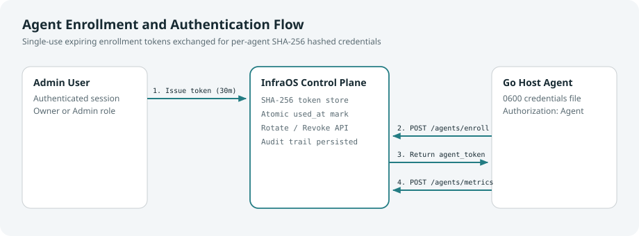

# InfraOS Telemetry Agent



## Supported Platforms

- **macOS** (`darwin/amd64`, `darwin/arm64`): Collects real CPU, cores, load averages, virtual memory, APFS filesystem usage (preferring `/System/Volumes/Data` for primary capacity), network interface counters and throughput deltas, uptime, OS process count, and optional laptop battery status via `/usr/bin/pmset -g batt`.
- **Linux** (`linux/amd64`, `linux/arm64`): Collects standard `/proc` and filesystem metrics plus optional thermal readings from `/sys/class/thermal/thermal_zone*/temp` and battery capacity from `/sys/class/power_supply/BAT*` only when readable without root privileges.

Unsupported optional metrics are omitted rather than fabricated.

## Collection Mechanics

1. **Counter-reset-safe network throughput**: `pkg/collector.ComputeThroughput` stores the prior `(rxBytes, txBytes, timestamp)` sample per interface and in aggregate. If a counter resets (`current < previous`), throughput safely returns `0` instead of underflowing `uint64`.
2. **Bounded retry queue**: Up to 60 samples are buffered in memory during temporary API outages. Oldest entries are dropped once the cap is reached so agent RAM usage remains bounded.
3. **Exponential backoff with jitter**: Failed deliveries back off exponentially up to 60 seconds plus random jitter to prevent thundering herds after control plane restarts.
4. **Privilege model**: Basic telemetry requires zero root privileges. Credentials are persisted locally with `0600` permissions.

## Optional Linux systemd Unit

InfraOS never installs persistent launch agents or system services automatically. On an authorized Linux host, operators can create `/etc/systemd/system/infraos-agent.service`:

```ini
[Unit]
Description=InfraOS Host Telemetry Agent
After=network-online.target
Wants=network-online.target

[Service]
Type=simple
User=infraos-agent
Group=infraos-agent
Environment=INFRAOS_AGENT_API_URL=https://infraos.example.com
Environment=INFRAOS_AGENT_CREDENTIALS_PATH=/var/lib/infraos-agent/credentials.json
Environment=INFRAOS_AGENT_INTERVAL_SECONDS=15
ExecStart=/usr/local/bin/infraos-agent
Restart=on-failure
RestartSec=10
NoNewPrivileges=true
ProtectSystem=strict
ProtectHome=true
ReadWritePaths=/var/lib/infraos-agent

[Install]
WantedBy=multi-user.target
```
