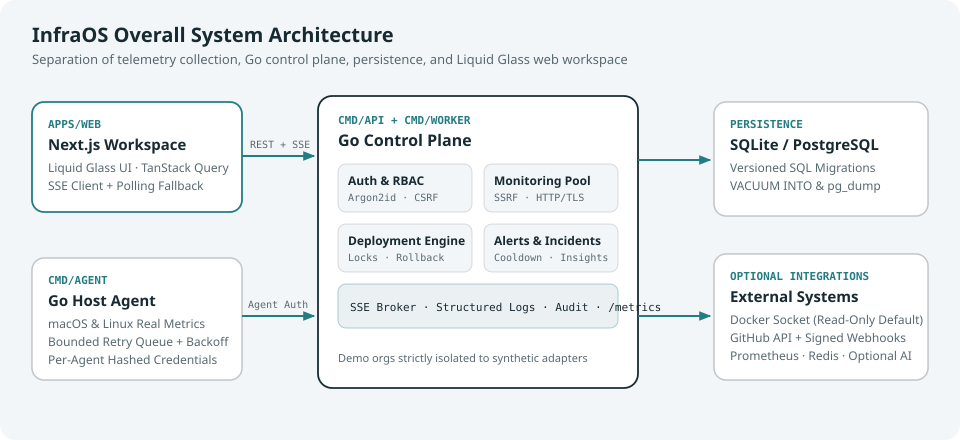
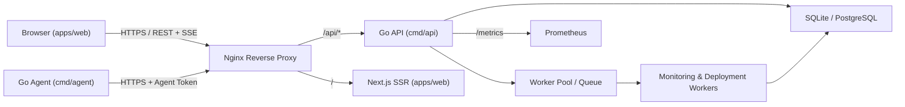

# InfraOS System Architecture

InfraOS is a self-hosted infrastructure operations platform built with a Go control plane (`cmd/api`, `cmd/worker`), a cross-platform Go telemetry agent (`cmd/agent`), SQLite and PostgreSQL persistence, and a Next.js App Router workspace (`apps/web`).

## Logical Components

1. **Web workspace (`apps/web`)**: Next.js App Router, React 19, TypeScript strict mode, Tailwind CSS v4, TanStack Query, Recharts, interactive SVG topology canvas, and Server-Sent Events (SSE) with reconnect and polling fallback.
2. **Core API service (`cmd/api`)**: Chi HTTP router, structured `slog` JSON logging, Argon2id user authentication, per-agent credential authentication, RBAC middleware, Prometheus `/metrics`, OpenAPI 3.1 schema, and SSE broker.
3. **Host telemetry agent (`cmd/agent`)**: Non-root macOS and Linux collector transmitting CPU, memory, load average, mounted filesystems, network throughput deltas, uptime, and optional platform metrics over authenticated HTTP with exponential backoff and a bounded retry buffer.
4. **Monitoring scheduler (`internal/monitoring`)**: Bounded goroutine worker pool executing SSRF-validated HTTP, HTTPS, TCP, DNS, and TLS expiration checks.
5. **Background worker (`cmd/worker` or embedded in lightweight mode)**: Runs scheduled monitoring sweeps, deployment jobs, alert rule evaluation, and retention pruning.
6. **Persistence (`internal/database`)**: Normalized SQLite (WAL mode) and PostgreSQL schemas with versioned embedded SQL migrations, explicit transaction boundaries, and query placeholder rebinding.
7. **Deployment engine (`internal/deployments`)**: State machine (`queued`, `preparing`, `building`, `deploying`, `verifying`, `succeeded`, `failed`, `rolling_back`, `rolled_back`) with atomic SQL per-target locking, idempotency keys, health verification, and artifact rollback.
8. **Observability, alerts, incidents, and audit (`internal/logs`, `internal/alerts`, `internal/incidents`, `internal/audit`, `internal/intelligence`)**: Credential-redacting structured logs, anti-storm alert rules, deduplicated incidents, deterministic anomaly analysis, optional disabled-by-default AI summaries, and immutable audit logs.

## How Requests and Data Travel Through InfraOS

### HTTP Request Lifecycle
Every API request enters the Chi middleware stack in `internal/api/server.go`:
1. `Recoverer` isolates panics.
2. `requestIDMiddleware` assigns or propagates `X-Request-ID`.
3. `securityHeadersMiddleware` sets `X-Content-Type-Options`, `X-Frame-Options`, `Referrer-Policy`, and `Permissions-Policy`.
4. `corsMiddleware` validates `Origin` against explicit `INFRAOS_ALLOWED_ORIGINS`.
5. `observabilityMiddleware` records Prometheus request counters, latency histograms, 5xx counters, and emits structured `slog` JSON logs.
6. Authenticated routes run `requireSession` (cookie or Bearer SHA-256 lookup), `csrfMiddleware` (validating `X-CSRF-Token` on cookie-backed mutations), and `requirePerm` (server-side RBAC check).

### Go Concurrency Patterns Used
- **Context cancellation**: `signal.NotifyContext` cancels the HTTP server, worker pool, monitoring scheduler, and retention loop cleanly on `SIGINT` or `SIGTERM`.
- **Bounded worker pools**: `internal/queue` uses a buffered channel plus fixed worker goroutines; `internal/monitoring` bounds concurrent network probes with a semaphore channel (`make(chan struct{}, maxConcurrency)`) and an in-flight map protected by a mutex.
- **Non-blocking SSE fan-out**: `internal/sse` maintains org-scoped subscriber channels protected by `sync.RWMutex` and uses non-blocking `select` sends so a slow browser tab never stalls metric ingestion.
- **Database transactions & locks**: Agent enrollment consumes one-time tokens atomically (`UPDATE ... WHERE used_at IS NULL`), and deployments claim target locks atomically (`UPDATE deployment_targets SET locked_by_deployment_id = ? WHERE locked_by_deployment_id IS NULL`) to prevent race conditions.

## Architecture Diagrams

- [Overall System Architecture](../assets/diagrams/system-architecture.svg)
- [Agent Enrollment and Authentication](../assets/diagrams/agent-enrollment-auth.svg)
- [Metrics Ingestion Pipeline](../assets/diagrams/metrics-ingestion.svg)
- [Service Monitoring Lifecycle](../assets/diagrams/monitoring-lifecycle.svg)
- [Controlled Deployment Workflow](../assets/diagrams/deployment-workflow.svg)
- [Incident Lifecycle](../assets/diagrams/incident-lifecycle.svg)
- [Security Boundaries](../assets/diagrams/security-boundaries.svg)
- [Production Deployment Topology](../assets/diagrams/production-topology.svg)
