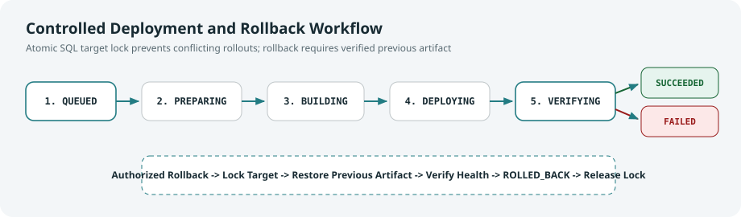

# Controlled Deployment Architecture

## Deployment Lifecycle

Every deployment follows explicit persisted states recorded in `deployments` and `deployment_events`:
1. `queued`
2. `preparing`
3. `building`
4. `deploying`
5. `verifying`
6. `succeeded` or `failed` (or `cancelled` on timeout)
7. `rolling_back` -> `rolled_back` when explicitly initiated by an authorized operator

## Safety Guarantees

- **Atomic target locks**: Before inserting a deployment, `internal/deployments` executes a conditional SQL update (`WHERE locked_by_deployment_id IS NULL`). Concurrent releases targeting the same service fail fast with HTTP 409 Conflict.
- **Idempotency keys**: Submitting the same `idempotency_key` (or `X-Idempotency-Key` header) returns the original deployment rather than queuing duplicate releases.
- **No arbitrary shell execution**: The API accepts structured release metadata and executes only predefined adapters (`local_http`, `simulation`, `docker_compose`).
- **Verified rollback**: Rollback locates a recorded previous artifact, locks the target, runs health verification (`local_http`), and marks `rolled_back` only after verification succeeds.
- **Honest simulation labeling**: When operating on simulation targets or in demo workspaces, `is_simulation: true` is persisted and displayed in the UI.
