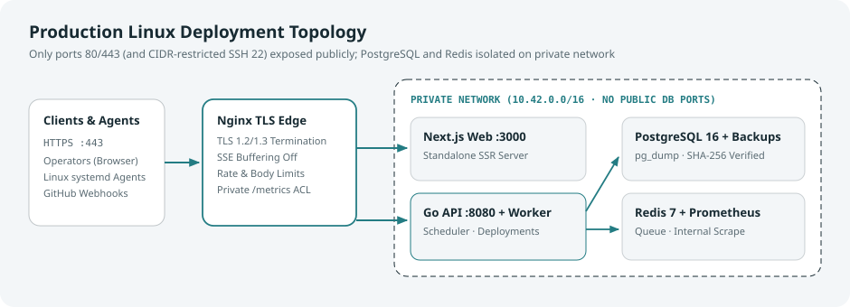

# Networking and Reverse Proxy Architecture

## Reverse Proxy Behavior (`infrastructure/nginx/nginx.conf`)

In the infrastructure and production profiles, Nginx sits in front of both Next.js (`web:3000`) and the Go API (`api:8080`):
- `/` proxies to the Next.js standalone server.
- `/api/` proxies to the Go control plane with a `30r/s` rate limit (`limit_req_zone`) and `2m` body cap.
- `/api/v1/auth/login` uses a stricter `5r/m` rate limit layered ahead of Go's in-process per-IP rate limiter.
- `/api/v1/events/stream` uses a dedicated Server-Sent Events location with `proxy_buffering off`, `proxy_cache off`, HTTP/1.1 keepalive, and a `3600s` read timeout so live updates stream without premature disconnects.
- `/metrics` is restricted by IP ACL to loopback and private RFC1918 networks so Prometheus scrapes remain internal.

## Port Mapping and Isolation

- **Exposed on edge (production)**: `80/tcp` (ACME challenge and redirect), `443/tcp` (TLS 1.2/1.3), and `22/tcp` restricted to explicit `admin_cidr_blocks`.
- **Internal only**: `web:3000`, `api:8080`, `postgres:5432`, `redis:6379`, and `prometheus:9090`. Neither PostgreSQL nor Redis is bound to public host interfaces in `docker-compose.yml`.

## TLS Termination

`infrastructure/nginx/tls.conf.template` documents a production HTTPS server block using TLS 1.2/1.3, HSTS, and Let's Encrypt certificate paths. InfraOS does not generate fake certificates or claim HTTPS is active locally without real certificate provisioning.
