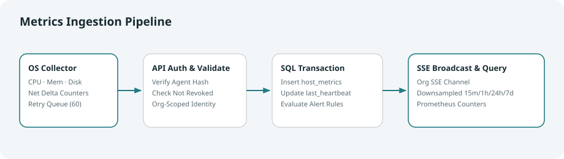

# Observability

InfraOS instruments its own control plane so operators can observe InfraOS health independently of the UI.

## Prometheus Metrics (`GET /metrics`)

Exposed using `prometheus/client_golang` with bounded, low-cardinality labels (`method`, `route`, `status`, `job_type`, `outcome`, `operation`):
- `infraos_http_requests_total`
- `infraos_http_request_duration_seconds`
- `infraos_http_errors_total`
- `infraos_monitoring_active_jobs`
- `infraos_agent_heartbeats_total`
- `infraos_host_metrics_ingested_total`
- `infraos_deployment_queue_size`
- `infraos_worker_job_duration_seconds`
- `infraos_database_errors_total`

Optional Prometheus scrape and alert definitions live in `infrastructure/prometheus/prometheus.yml` and `infrastructure/prometheus/alerts.yml`.

## Structured Logging & Health Probes

- Structured JSON logs via Go `log/slog` including `request_id`, HTTP route pattern, status, duration, and remote IP.
- `GET /healthz`: Liveness probe returning process health and active profile.
- `GET /readyz`: Readiness probe executing `db.Ping(ctx)` and returning HTTP 503 if persistence is unreachable.

## OpenTelemetry

`pkg/telemetry.InitOTel` provides configurable exporter wiring controlled by `INFRAOS_OTEL_ENABLED` and `INFRAOS_OTEL_EXPORTER_ENDPOINT`. External telemetry export is disabled by default.
