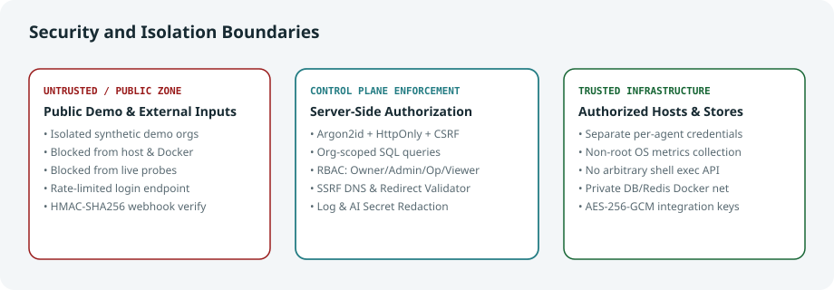

# Security Architecture

## Implemented Controls

1. **Password and session hygiene**: Passwords use Argon2id (`time=1`, `memory=64 MiB`, `threads=2`, 16-byte CSPRNG salt). Session tokens are 256-bit random values stored exclusively as SHA-256 hashes, delivered via `HttpOnly`, `SameSite=Lax` cookies (`Secure` enforced in production).
2. **CSRF protection**: Cookie-authenticated state-changing HTTP methods require a matching `X-CSRF-Token` header tied to the session.
3. **Login rate limiting**: Fixed-window per-IP rate limiting caps brute-force attempts on `/api/v1/auth/login` (layered beneath Nginx rate limiting in infrastructure/production profiles).
4. **Role-based access control & tenancy**: Every endpoint authorizes the caller's role (`owner`, `admin`, `operator`, `viewer`) server-side and filters every SQL statement by `organization_id`. Viewers cannot mutate any infrastructure resource.
5. **Separate agent authentication**: Agents enroll via single-use expiring tokens consumed atomically inside SQL transactions and receive per-agent hashed credentials (`Authorization: Agent <token>`) supporting immediate rotation and revocation.
6. **SSRF prevention**: `internal/security.SSRFValidator` rejects cloud metadata IPs (`169.254.169.254`, `169.254.170.2`, `100.100.100.200`, `fd00:ec2::254`), link-local ranges, RFC1918 private addresses, CGNAT, and non-allowlisted loopback targets across initial DNS lookups and HTTP redirects.
7. **No arbitrary shell execution**: No API endpoint accepts shell scripts or interpolates user input into shell commands.
8. **Credential redaction & encryption**: Structured logs and optional AI summaries redact tokens, passwords, private keys, and DSN credentials before storage or transmission. Optional integration secrets are encrypted with AES-256-GCM server-side.
9. **Signed webhooks**: GitHub webhooks require valid constant-time HMAC-SHA256 verification (`X-Hub-Signature-256`) and reject duplicate `X-GitHub-Delivery` IDs.
10. **Demo isolation**: Public demonstration sessions create isolated synthetic organizations denied access to local host sockets, live probes, real deployments, and real backups.
